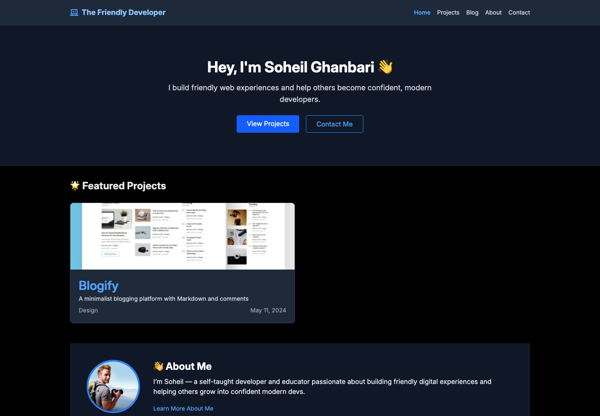

# The Friendly Dev — Portfolio & Blog

[](https://github.com/Soheil86/friendly-dev/actions/workflows/ci.yml)

A server-rendered portfolio and blog built with **React Router v8 (framework mode)**, **React 19**, **TypeScript** and **Tailwind CSS v4**. All content (projects and blog posts) is managed in a headless **Strapi 5** CMS, so new content goes live without a redeploy.

**🔗 Live demo:** [friendly-dev-dun.vercel.app](https://friendly-dev-dun.vercel.app)
**🗄️ Backend repo:** [Soheil86/friendly-dev-backend](https://github.com/Soheil86/friendly-dev-backend)



## Features

- **Server-side rendering** with route `loader`s — pages arrive fully rendered, which is good for SEO and first paint
- **Featured projects** on the homepage, filtered on the API side (`filters[featured][$eq]=true`)
- **Projects page** with category filtering and detail pages
- **Blog** with client-side search, pagination and Markdown rendering (`react-markdown` + Tailwind Typography)
- **Latest posts** section on the homepage, sorted by date
- **Contact form** powered by Formspree
- Animated project grid transitions with **Framer Motion**
- Custom 404 page and a root error boundary
- Fully typed: Strapi API responses are mapped into typed domain models (`app/types.ts`)

## Tech stack

| Area      | Tools                                                  |
| --------- | ------------------------------------------------------ |
| Framework | React 19, React Router v8 (framework mode, SSR), Vite  |
| Language  | TypeScript                                             |
| Styling   | Tailwind CSS v4, @tailwindcss/typography               |
| Content   | Strapi 5 (headless CMS, REST API), Cloudinary for media |
| Other     | Framer Motion, React Icons, React Markdown             |
| Deploy    | Vercel (frontend), Docker-ready                        |
| CI        | GitHub Actions (typecheck + build)                     |

## Architecture

```
┌──────────────────────┐    REST (fetch in loaders)    ┌───────────────────┐
│  React Router (SSR)  │ ────────────────────────────▶ │   Strapi 5 API    │
│  Vercel              │                               │   PostgreSQL      │
└──────────────────────┘                               └─────────┬─────────┘
           ▲                                                     │
           │                images                     ┌─────────▼─────────┐
           └────────────────────────────────────────── │    Cloudinary     │
                                                       └───────────────────┘
```

Every route that needs data fetches it in a server `loader`, then maps the raw Strapi response (`{ data: [...], meta }`) into a flat, typed model before passing it to components. Components never depend on the CMS response shape.

## Project structure

```
app/
├── components/      # Reusable UI (ProjectCard, PostCard, Pagination, PostFilter, ...)
├── routes/
│   ├── home/        # Hero, featured projects, latest posts
│   ├── projects/    # List + /projects/:id detail
│   ├── blog/        # List + /blog/:slug detail
│   ├── about/  contact/  errors/
│   └── layouts/     # Home and main layouts
├── utils/           # Date formatting, image URL helper
├── types.ts         # Domain + Strapi response types
└── root.tsx         # HTML shell, meta, error boundary
```

## Getting started

**Prerequisites:** Node.js 20+ and a running instance of the [backend](https://github.com/Soheil86/friendly-dev-backend).

```bash
git clone https://github.com/Soheil86/friendly-dev.git
cd friendly-dev
npm install
cp .env.example .env   # then point VITE_API_URL at your Strapi API
npm run dev            # http://localhost:5173
```

| Variable          | Description                                 |
| ----------------- | ------------------------------------------- |
| `VITE_API_URL`    | Strapi REST API base URL, e.g. `http://localhost:1337/api` |
| `VITE_STRAPI_URL` | Strapi server URL, e.g. `http://localhost:1337` |

### Scripts

| Command             | Description                          |
| ------------------- | ------------------------------------ |
| `npm run dev`       | Start the dev server with HMR        |
| `npm run build`     | Production build                     |
| `npm run start`     | Serve the production build           |
| `npm run typecheck` | Generate route types and run `tsc`   |

### Docker

```bash
docker build -t friendly-dev .
docker run -p 3000:3000 friendly-dev
```

## What I learned

- **Migrating from a mock API to a real CMS.** The project started on `json-server` and moved to Strapi. Keeping a mapping layer in the loaders meant only the loaders changed, not the components.
- **Typing third-party responses.** Strapi wraps everything in `{ data, meta }`. Returning that object directly caused a `projects.filter is not a function` runtime error, which I fixed by typing the response (`StrapiResponse<T>`) and always unwrapping `data` in the loader.
- **SSR data loading** with React Router loaders, parallel fetching with `Promise.all`, and route-level error handling (404 vs. server errors).

## Roadmap

- [ ] Unit tests with Vitest + React Testing Library
- [ ] Open Graph / social preview meta tags per post
- [ ] Dark/light theme toggle
- [ ] Contact form validation with inline feedback

## Author

**Soheil Ghanbari** — [GitHub](https://github.com/Soheil86)
